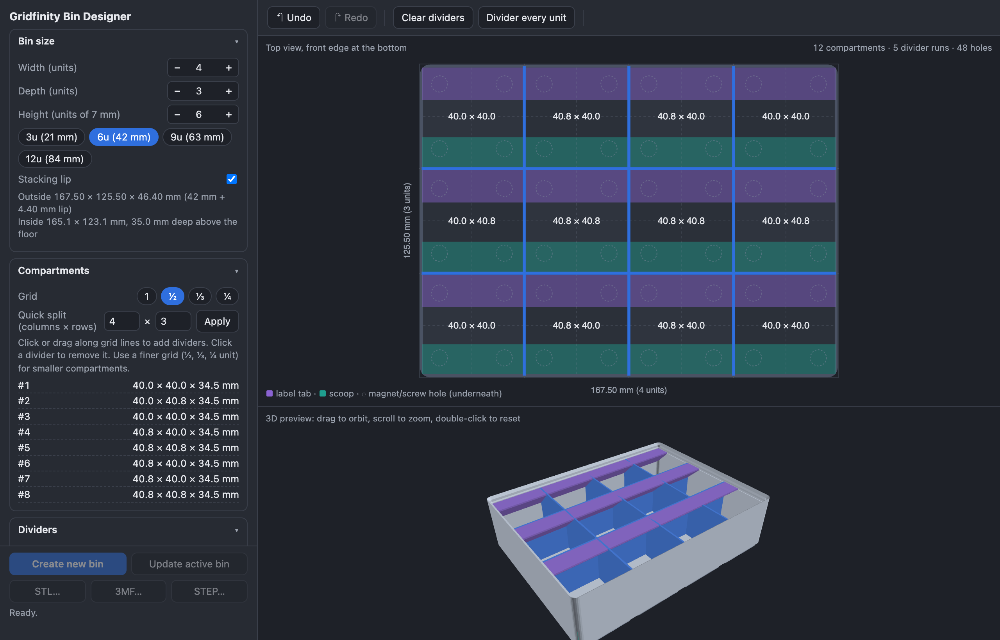
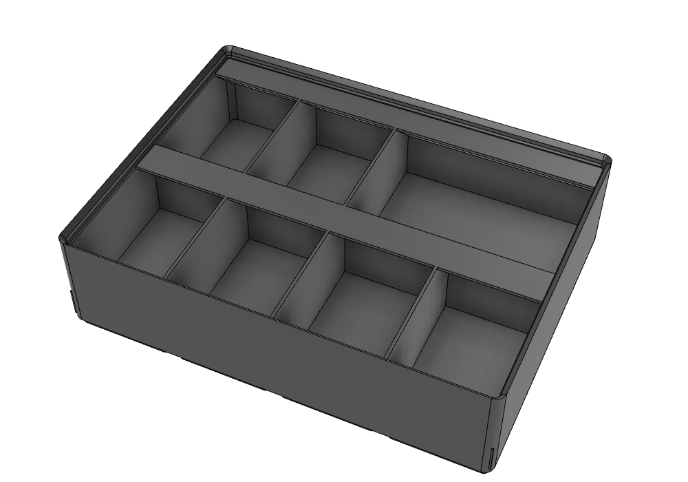

# Gridfinity Bin Designer

[](https://github.com/fatofthelan/gridfinity-bin-designer/actions/workflows/tests.yml)

A free Autodesk Fusion add-in for designing 3D-printable **Gridfinity** bins.

You size the bin on the 42 mm grid and draw compartments in a top-view editor with a live 3D preview. Label tabs, finger scoops and magnet/screw holes are checkboxes. Then you build a parametric bin in Fusion and export it as STL, 3MF or STEP.





## Features

- **Spec-accurate Gridfinity geometry**:
  - 42 mm grid with 0.25 mm clearance per side (41.5 mm per unit), 7 mm height units.
  - Feet with the 0.8 / 1.8 / 2.15 mm profile and 3.75 mm corner radius.
  - Optional stacking lip matching the baseplate socket profile, so bins stack on each other.
- **Compartment editor**:
  - Click or drag along grid lines to add dividers, and click a divider to remove it.
  - 1, ½, ⅓ or ¼ unit grid, quick split into even columns × rows, and undo/redo.
  - A live list of compartment sizes.
- **Label tabs** at the back of every compartment: depth, support angle, width and alignment are adjustable. At the default 45° support angle they print without supports.
- **Finger scoops** at the front of every compartment. They shrink automatically in small compartments.
- **Magnet and screw holes**: 6.5 × 2.4 mm magnet holes, 3 mm screw holes, or both, in every foot or only the outer corners.
- **Live 3D preview** that you can orbit and zoom.
- **Parametric model**:
  - Fully constrained sketches and named user parameters (`NumUnitsX`, `NumUnitsY`, `HeightUnits`, `GridPitch`, `BinClearance`, …).
  - Dividers, tabs and scoops are one exact solid that the designer regenerates.
- **Update in place**: change the layout and rebuild the active bin as a single undo step, or turn on auto-update.
- **Built-in verification**: every build reads the result back and checks:
  - one solid body of the expected size,
  - the volume against the spec value,
  - the foot and lip profiles,
  - every divider, tab, scoop and hole,
  - every compartment empty.
- **Editable fit and hole sizes**, with the spec values shown next to each field and a one-click reset.
- **Export** to STL, 3MF or STEP with versioned file names (`gridfinity-bin-3x2x6u-v1.stl`, …). Existing files are never overwritten.
- **Saved layouts** for bins you print often.
- Validation catches impossible settings (tabs taller than the bin, holes that don't fit on the foot, and so on) before anything is built.

## Requirements

- Autodesk Fusion (a current release; personal, commercial and education licenses all work).
- macOS or Windows. Development and testing were done on macOS. Windows uses the same code paths, but please report any problems.

## Installation

1. Download `GridfinityBinDesigner-<version>.zip` from the [latest release](https://github.com/fatofthelan/gridfinity-bin-designer/releases/latest) and unzip it (or clone this repository).
2. Put the `GridfinityBinDesigner` folder (the one containing `GridfinityBinDesigner.manifest`) into Fusion's add-ins folder:
   - **macOS:** `~/Library/Application Support/Autodesk/Autodesk Fusion 360/API/AddIns/`
   - **Windows:** `%APPDATA%\Autodesk\Autodesk Fusion 360\API\AddIns\`

   Alternatively, in Fusion open **UTILITIES › Add-Ins › Scripts and Add-Ins**, click **+** next to *My Add-Ins*, and select the folder wherever it lives.
3. In **Scripts and Add-Ins**, select *GridfinityBinDesigner* and click **Run**. Tick *Run on Startup* to keep it loaded.
4. Open it from **SOLID › CREATE › Gridfinity Bin Designer**.

## Usage

1. **Bin size**: set the width and depth in grid units (42 mm) and the height in 7 mm units. Choose whether you want a stacking lip.
2. **Compartments**: pick a grid (1, ½, ⅓ or ¼ unit), then click or drag on grid lines, or use *Quick split*. Each compartment's inside size appears in the editor and in the list.
3. **Dividers**: set the thickness (a multiple of your extrusion width works best) and how far below the top they stop.
4. **Label tabs & scoops**: tick them and adjust the sizes. Tabs appear in purple and scoops in teal in the editor.
5. **Base**: choose magnet holes, screw holes or both.
6. **Create new bin** builds the bin in a new, unsaved Fusion document. Save it wherever you like.
7. Edit the layout, then **Update active bin** to rebuild it in place. **Load from active bin** reads a saved bin's layout back into the editor.
8. **STL… / 3MF… / STEP…** exports the bin.

### Printing tips

- Print open side up with no supports. The feet's 45° chamfers, the lip and label tabs with a support angle of 45° or more are all self-supporting.
- The 1.2 mm walls print as 3 lines with a 0.4 mm nozzle. A 1.2 mm divider prints as about 3 lines.
- Magnet holes are sized for 6 × 2 mm magnets. Press fits vary between printers and filaments, so print one 1 × 1 bin first and adjust *Magnet hole diameter* if needed.
- If bins sit too tight or too loose in your baseplate, adjust *Clearance per side* under **Fit & tolerances**.

## How the model is built

| Feature | What it does |
|---|---|
| `GBD Foot …` + `GBD Foot Pattern` | One foot (0.8 / 1.8 / 2.15 mm profile, tapered extrudes), patterned over the grid |
| `GBD Block …` | Outer block from the top of the feet to the top of the lip, corner radius `BinCornerRadius` |
| `GBD Layout Join Feet` | Joins the feet to the block |
| `GBD Layout Cavity …` | Cuts the inside: straight walls, the 45° support under the lip, and the stacking lip profile |
| `GBD Layout Interior` | Base feature with the union of dividers, label tabs and scoops, joined to the bin |
| `GBD Layout Holes` | Base feature with the magnet/screw holes, cut from the bin |

The layout is stored in the document (attribute `GridfinityBinDesigner/config`). Saved layouts and settings live in a per-user folder: `~/Library/Application Support/GridfinityBinDesigner` on macOS, `%APPDATA%\GridfinityBinDesigner` on Windows.

**Editing a bin by hand:** add your own features *after* the last `GBD Layout` feature. *Update active bin* deletes and regenerates every `GBD Layout …` feature. Features that reference that geometry may need repairing after an update. Changing `NumUnitsX`, `HeightUnits` and similar parameters by hand resizes the feet and block, but the layout features only follow after *Update active bin*.

## Limitations

- Compartments follow the grid (down to ¼ unit). Free-form divider positions aren't supported yet.
- No baseplate generator, lids or half-grid (21 mm) bins yet.
- The 3D preview is a lightweight approximation. The Fusion model is the reference.

## Development

```
GridfinityBinDesigner/
  GridfinityBinDesigner.py  add-in entry point, palette bridge, undoable update command
  gbd_layout.py             layout rules, spec values and validation (pure Python, no Fusion)
  gbd_builder.py            Fusion geometry, read-back verification, export
  palette/                  HTML/CSS/JS user interface (layout.js mirrors gbd_layout.py)
tests/
  test_layout.py            unit tests for the layout rules
  test_parity.py            checks that layout.js and gbd_layout.py agree (needs Node.js)
  fusion_smoke_test.py      integration test, run inside Fusion
tools/
  make_icons.py             regenerates the toolbar icons
```

Run the tests outside Fusion with:

```
python3 -m unittest discover -s tests -v
```

For the integration test, add `tests/fusion_smoke_test.py` in **Scripts and Add-Ins** and run it. It builds bins in temporary documents, checks them against the spec (including a stacking test), and closes only the documents it created.

You can open `palette/index.html` directly in a browser to work on the UI. It runs in preview mode without Fusion.

## Credits

Gridfinity was created by Zack Freedman. The dimensions follow the community specification at <https://gridfinity.xyz/specification/> and were cross-checked against [gridfinity-rebuilt-openscad](https://github.com/kennetek/gridfinity-rebuilt-openscad). See [NOTICE.md](NOTICE.md).

## License

The code is released under the [MIT License](LICENSE).
